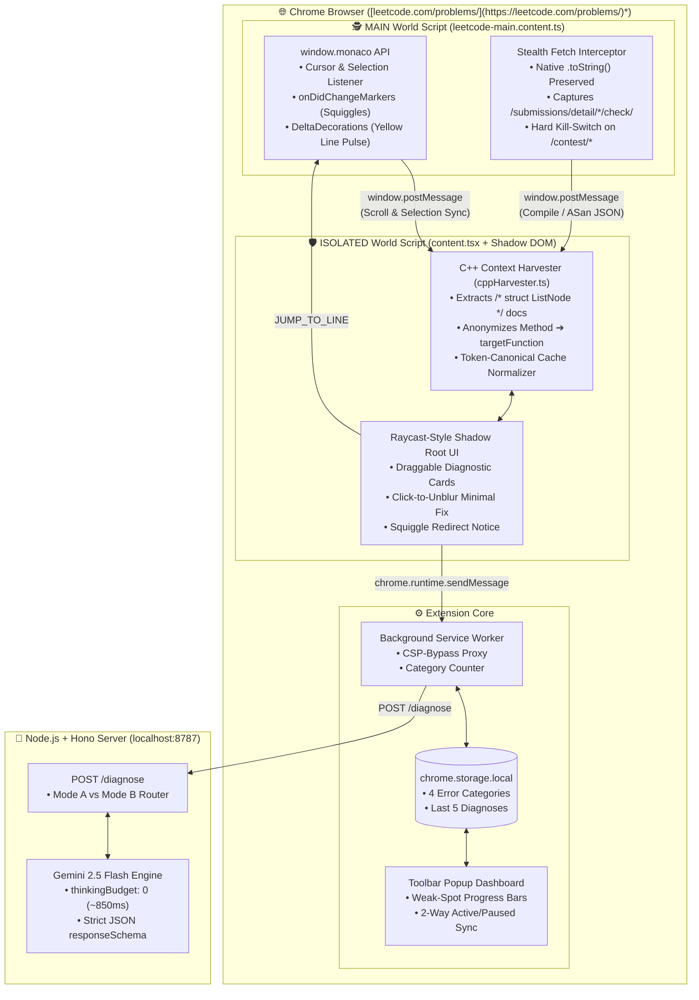

<div align="center">

# ⚡ CodeCheck C++ (`sin-checker`)

### **Problem-Blind C++ Language Diagnostics & AddressSanitizer State Tracer for LeetCode**

*Understand your C++ compiler errors, STL quirks, and memory crashes—without spoiling the algorithm.*

[](https://wxt.dev)
[](https://react.dev)
[](https://tailwindcss.com)
[](https://hono.dev)
[](https://ai.google.dev)
[](https://isocpp.org)

---

[**Why CodeCheck?**](#-why-codecheck-exists) •
[**System Architecture**](#-system-architecture) •
[**Dual-Mode Pipeline**](#-dual-mode-diagnostic-engine) •
[**Engineering Highlights**](#-under-the-hood-engineering-highlights) •
[**Quick Start**](#-local-setup--installation)

</div>

---

## 🎯 Why CodeCheck Exists

C++ learners on LeetCode face two massive friction points that Python and JavaScript users rarely see:
1. **Cryptic Template & Type Diagnostics:** A single mismatched constructor argument or `std::priority_queue` comparator mistake throws 40 lines of `std::_Rb_tree` template instantiation errors.
2. **Opaque `AddressSanitizer` Stack Traces:** A circular linked list or `nullptr` dereference crashes at `Line 65 in __ListNodeUtils__::freeList(ListNode*&)`—inside LeetCode's hidden driver code, dozens of lines past the user's actual function.

When learners paste their code into generic AI coding assistants, **the AI recognizes the problem name (`mergeTwoLists`, `reverseList`) and spits out the optimal DSA algorithm**, ruining the learning process.

> [!IMPORTANT]
> **The CodeCheck Philosophy:** CodeCheck never reads the problem description and **mathematically blinds the LLM to the problem identity** by anonymizing function symbols (`reverseList` ➔ `targetFunction`) before code ever leaves the browser. It diagnoses **C++ mechanics only**—never the algorithm.

### ⚔️ Generic AI Extensions vs. CodeCheck C++

| Feature | Generic "LeetCode GPT" Wrappers | ⚡ **CodeCheck C++ (`sin-checker`)** |
| :--- | :--- | :--- |
| **Problem Context** | Scrapes problem title & description | **Strictly Excluded & Function-Anonymized** |
| **Pedagogical Guardrail** | Soft prompt (*"Please give a hint"*) | **Schema-Enforced** + **Click-to-Unblur Fix** |
| **Editor Integration** | Fragile DOM `.querySelector` scraping | **Direct `window.monaco` API Bridge (`MAIN` World)** |
| **Crash Capture** | Scrapes HTML text after render | **Stealth `window.fetch` Stream Clone Interceptor** |
| **`AddressSanitizer` Support** | Dumps full rewritten solution | **3-Arrow Variable State Trace + 1-Click Line Jump** |
| **Repeat Lookup Latency** | Re-runs LLM call on every click (5–15s) | **0ms Token-Canonical C++ Cache (`~850ms` cold)** |

---

## 🏗️ System Architecture

CodeCheck uses a **Dual-World Manifest V3 Architecture** to bridge LeetCode's isolated React SPA / Monaco instance with an isolated **Shadow DOM UI** and a low-latency **Hono + Gemini 2.5 Flash** backend.



---

## 🔍 Dual-Mode Diagnostic Engine

### 1️⃣ Mode A: Syntax, Types & STL Debugger (In-Editor)
Triggered when a learner **highlights 1–5 lines of C++** (spawning an above-line pill) or **automatically upon red squiggle detection** (spawning a same-line pill next to the broken statement).

```text
┌──────────────────────────────────────────────────────────────────────────┐
│ ⠿ Drag to move                                                         ✕ │
│ ┌──────────────────────────────────────────────────────────────────────┐ │
│ │ ┃ The 2-argument ListNode constructor expects (int, ListNode*),      │ │
│ │ ┃ but 'sn' and 'sns' are undeclared identifiers in this scope.       │ │
│ │                                                                      │ │
│ │ ┌──────────────────────────────────────────────────────────────────┐ │ │
│ │ │ ░░░░░░░░░░░░░░░░░ 👁️ Click to reveal minimal fix ░░░░░░░░░░░░░░░ │ │ │
│ │ └──────────────────────────────────────────────────────────────────┘ │ │
│ │                                                                      │ │
│ │ (🔗 Line 14 · ListNode* temp=new ListNode…)                          │ │
│ └──────────────────────────────────────────────────────────────────────┘ │
│  🔵 Syntax & Types                                    [ Close ] [ Copy ] │
└──────────────────────────────────────────────────────────────────────────┘
```

* **Progressive Disclosure (`Click-to-Unblur`):** The 1-line C++ syntax fix starts blurred (`blur-[5px]`), encouraging the learner to read the conceptual explanation and type the fix themselves before revealing or copying the code.
* **Smart Squiggle Redirect:** If a compiler error marker exists on **Line 14**, but the user highlights a valid statement on **Line 20**, CodeCheck intercepts the action locally in **0ms** (zero API call) and offers a 1-click **`[Jump to Line 14 ↗]`** redirect.

---

### 2️⃣ Mode B: Runtime & `AddressSanitizer` Crash Tracer (Console)
Triggered when code compiles cleanly but crashes during execution (`heap-use-after-free`, `SEGV on unknown address`, `stack-overflow`, or `vector::_M_range_check`).

```text
┌──────────────────────────────────────────────────────────────────────────┐
│ ⠿ Drag to move                                                         ✕ │
│ ┌──────────────────────────────────────────────────────────────────────┐ │
│ │ ┃ Infinite Pointer Cycle: Node 1's next pointer points back to       │ │
│ │ ┃ itself, causing LeetCode's memory cleanup to free it twice.        │ │
│ │                                                                      │ │
│ │ ┌──────────────────────────────────────────────────────────────────┐ │ │
│ │ │ L15: temp = head       ──► Both pointers alias Node 1            │ │ │
│ │ │ L16: head->next = null ──► Severs rest of list (temp->next=null) │ │ │
│ │ │ L18: temp->next = head ──► 🔴 Points Node 1 back to itself       │ │ │
│ │ └──────────────────────────────────────────────────────────────────┘ │ │
│ │                                                                      │ │
│ │ (💥 Testcase: [1,2,3,4,5])                                           │ │
│ └──────────────────────────────────────────────────────────────────────┘ │
│  🔴 Pointers & Memory                      [ Close ] [ Culprit Line 18 ↗ ]│
└──────────────────────────────────────────────────────────────────────────┘
```

* **Harness Crash Translation:** Detects when `AddressSanitizer` crashes inside LeetCode's hidden `__ListNodeUtils__::freeList` deallocator (e.g., Line 65) and maps the root cause back to the exact pointer cycle on Line 18 of the user's code.
* **1-Click Culprit Line Pulse:** Clicking **`[Culprit Line 18 ↗]`** dispatches a command across the `MAIN` world bridge, scrolling Monaco via `editor.revealLineInCenter(18)` and pulsing a yellow delta decoration on the buggy line for 3 seconds.

---

### 3️⃣ 4-Category Weak-Spot Toolbar Dashboard
Clicking the Chrome extension icon opens a real-time analytics popup synced via `chrome.storage.local`:
* 🔵 **Syntax & Types** — Constructor signatures, type conversions, undeclared identifiers
* 🔴 **Pointers & Memory** — `nullptr` dereferences, pointer aliasing cycles, `AddressSanitizer` crashes
* 🟡 **STL & Containers** — Out-of-bounds `std::vector` access, iterator invalidation, comparator lambdas
* 🟢 **Scope & Return** — Missing non-void return paths, loop variable shadowing

---

## 🧠 Under-the-Hood Engineering Highlights

<details>
<summary><b>1. Problem-Blind AST/Lexer Anonymization (Anti-Spoiler Architecture)</b></summary>
<br/>

Prompting an LLM with *"Do not solve the problem"* fails frequently when the model sees a signature like `ListNode* mergeTwoLists(ListNode* list1, ListNode* list2)`. 

Before constructing the request payload, `utils/cppHarvester.ts`:
1. Extracts top `/* struct ListNode { ... } */` documentation blocks so the model knows available constructors and member types.
2. Runs a comment-safe signature scanner to identify the enclosing method name and replaces all occurrences with `targetFunction`.
3. Prefixes every line with its exact Monaco line number (`>>> L18 |`) so LLM trace steps align 1:1 with the editor.
</details>

<details>
<summary><b>2. Whitespace-Insensitive C++ Token Caching (0ms Repeat Lookups)</b></summary>
<br/>

Learners frequently close a popup, add an accidental space or blank line, and re-click the diagnostic pill. `normalizeCppForCache()` strips insignificant whitespace around C++ operators (`->`, `::`, `==`, `=`, `;`, `,`, `()`) to compute a canonical token key:

```ts
// Both resolve to the exact same cache key: "ListNode*temp=new ListNode(sn,sns);"
"ListNode* temp = new ListNode(sn, sns);"
"ListNode *temp=new ListNode( sn , sns ) ;"
```
</details>

<details>
<summary><b>3. Contest Integrity & Read-Only Editor Safety</b></summary>
<br/>

* **Hard Contest Kill-Switch:** `leetcode-main.content.ts` aborts immediately if `window.location.pathname.includes('/contest/')`.
* **Native Fetch Preservation:** Passive response cloning preserves `window.fetch.toString()` and never initiates additional requests to LeetCode's servers.
* **Read-Only Monaco Integration:** CodeCheck never auto-mutates or bulk-pastes code into Monaco; learners type fixes manually or copy single-line snippets.
</details>

---

## 📂 Project Structure

```text
sin-checker/
├── entrypoints/
│   ├── leetcode-main.content.ts   # MAIN world script: Monaco hooks, scroll sync & stealth fetch spy
│   ├── content.tsx                # ISOLATED world script: Mounts Shadow Root UI (cssInjectionMode: 'ui')
│   ├── CodeCheckOverlay.tsx       # Draggable cards, Mutex pill state, blur reveal & cache controller
│   ├── overlay.css                # Isolated Tailwind v4 stylesheet for Shadow DOM
│   ├── background.ts              # Service Worker proxy to Hono API + chrome.storage stats aggregator
│   └── popup/                     # Chrome toolbar 4-category C++ Weak-Spot Dashboard
│       ├── App.tsx
│       └── style.css
├── utils/
│   ├── types.ts                   # Shared TypeScript contracts & bridge message schemas
│   └── cppHarvester.ts            # Struct extractor, function anonymizer & C++ token normalizer
├── server/
│   ├── index.ts                   # Node.js + Hono API server with Gemini 2.5 Flash responseSchema
│   ├── package.json
│   └── .env                       # Private GEMINI_API_KEY (git-ignored)
└── wxt.config.ts                  # WXT + React module & Manifest V3 permissions config
```

---

## 🚀 Local Setup & Installation

### Prerequisites
* **Node.js** `v18+`
* **Google Gemini API Key** ([Get a free key from Google AI Studio](https://aistudio.google.com/apikey))

### 1. Clone the Repository & Install Extension Dependencies
```bash
git clone [https://github.com/arnav0406/sin-checker.git](https://github.com/arnav0406/sin-checker.git)
cd sin-checker
npm install
```

### 2. Configure & Start the Hono Backend Server
Open a second terminal and set up the `server/` directory:
```bash
cd server
npm install
```

Create a `.env` file inside `server/`:
```env
GEMINI_API_KEY=your_gemini_api_key_here
PORT=8787
```

Start the low-latency Hono server:
```bash
npx tsx index.ts
# 🚀 CodeCheck Fast Hono Server running on http://localhost:8787
```

### 3. Launch the WXT Extension in Development Mode
In your root `sin-checker` terminal:
```bash
npm run dev
```
> [!TIP]
> WXT will automatically open a Chrome instance with **CodeCheck C++** loaded. Navigate to any problem on `https://leetcode.com/problems/*`, select **C++** in the editor, and highlight a line or trigger a compiler/runtime error!

---

## 📜 License

Distributed under the **MIT License**. Built for C++ learners who want to master pointers, STL mechanics, and compiler diagnostics the right way.